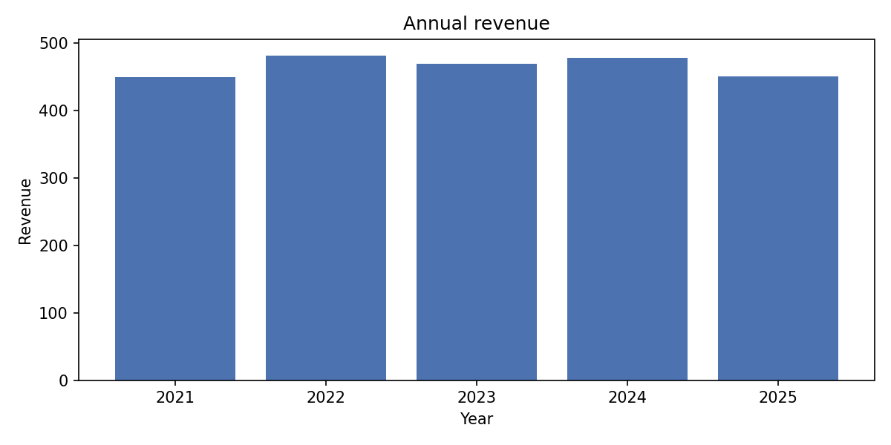
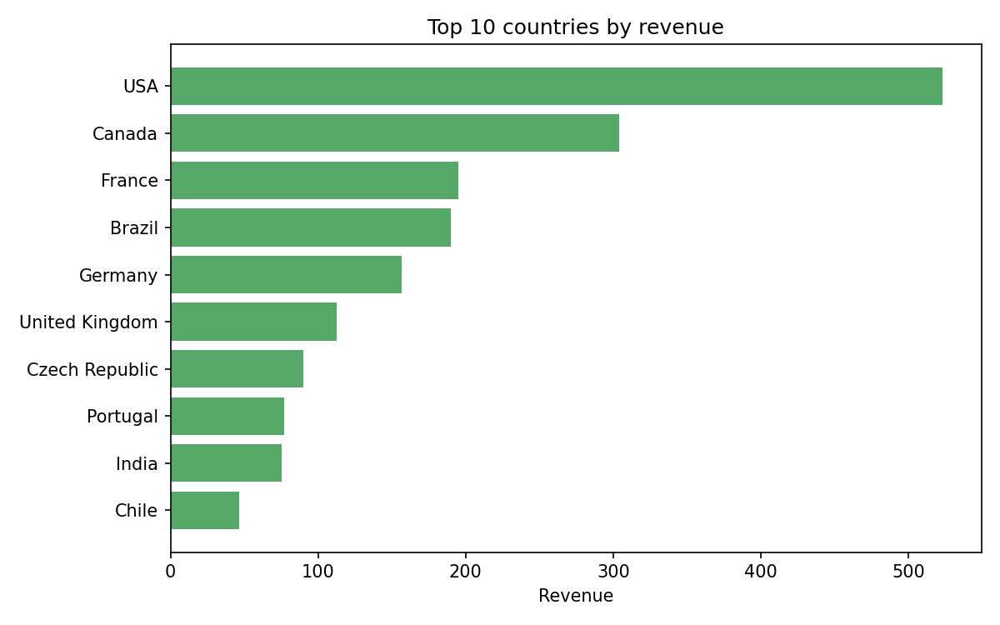
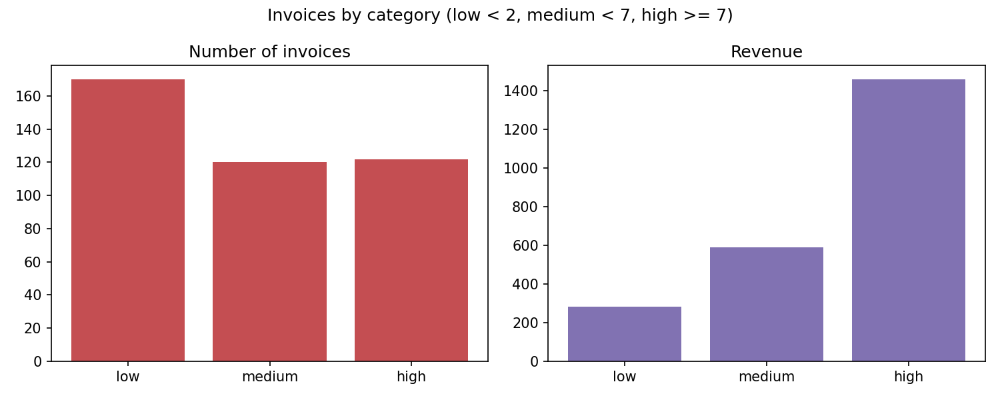
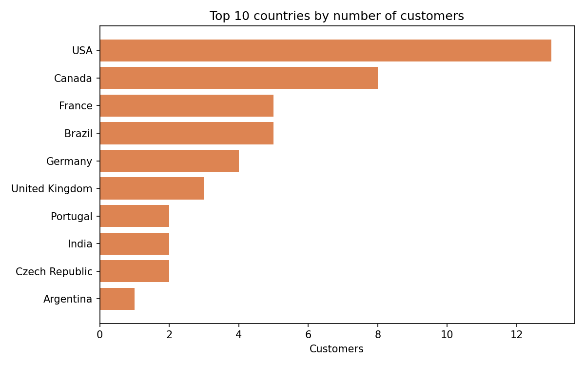

# Chinook Sales Analysis (SQL + Python)

Exploratory analysis of the Chinook sample database (a digital music store) using
SQL and Python. This is a practice project to consolidate core SQL skills
(filtering, aggregation, date functions and `CASE`) and integrate them with pandas.

## Questions

1. How do revenues evolve year over year?
2. Which countries generate the most revenue?
3. How much do low, medium and high-value invoices weigh in total revenue?
4. Where are the customers?

## Key findings

- **Annual revenue is stable, with no clear trend.** It ranges from 449.46 (2021) to
  481.45 (2022), about a 7% difference. There are 83 invoices per year (80 in 2025),
  so the variation comes from the average invoice value (5.42 to 5.80), not from volume.
- **2025 is almost a full year.** The data ends on 2025-12-22, which is consistent with
  its 3 missing invoices, although this cannot be confirmed from the data alone.
- **Revenue is concentrated.** The USA (22.5%) and Canada (13.1%) account for 35.6% of
  revenue. The top 5 countries make up 58.9% and the top 10 make up about 76%, out of
  24 countries.
- **The country ranking is explained by customer count.** Each customer has about 7
  invoices of similar value (overall average: 5.65), so countries with more customers
  lead in revenue. Only Czech Republic (6.45) and Chile (6.66) stand out on average
  invoice value, but their samples are very small (14 and 7 invoices). Such a uniform
  pattern suggests the data is synthetic.
- **A few large invoices carry most of the revenue.** "High" invoices (>= 7) are 29.6%
  of all invoices (122 of 412) but generate 62.6% of revenue. "Low" invoices (< 2) are
  41.3% of invoices but only 12.1% of revenue. The thresholds are arbitrary, so
  different cut-offs would change these percentages.

## Charts






## Project structure

```
├── Data/              # SQLite database (see note below)
├── Sql/               # one query per question
├── Charts/            # generated charts
├── analysis.ipynb     # analysis notebook
├── requirements.txt
└── README.md
```

## How to run

1. Download `Chinook_Sqlite.sqlite` from [LINK TO SOURCE] and place it in `Data/`.
2. Install the dependencies: `pip install -r requirements.txt`
3. Open `analysis.ipynb` and run all cells.

Each SQL query lives in its own file in `Sql/`, and the notebook reads and runs it
with `pandas.read_sql_query`.

## SQL concepts used

`SELECT`, `WHERE`, `GROUP BY`, `HAVING`, `ORDER BY`, aggregate functions
(`COUNT`, `SUM`, `AVG`, `ROUND`), `strftime` for dates, `CASE` for categories.

## Tools

SQLite, Python, pandas, matplotlib, Jupyter. Tested with pandas 2.3.3.

## Data Source

Chinook sample database, originally created by Luis Rocha ([source and license](https://github.com/lerocha/chinook-database/)).

In this version of the database, invoice dates range from 2021-01-01 to 2025-12-22. This is sample data, so the conclusions should not be extrapolated to a real business.

## License

The Chinook database is distributed under the MIT License. Copyright (c) 2008–2024 Luis Rocha.

The original MIT License and its copyright notice are available in the ([Chinook repository](https://github.com/lerocha/chinook-database/)).
